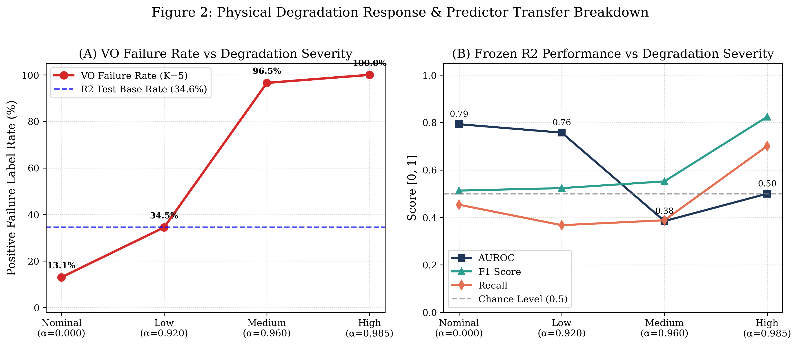
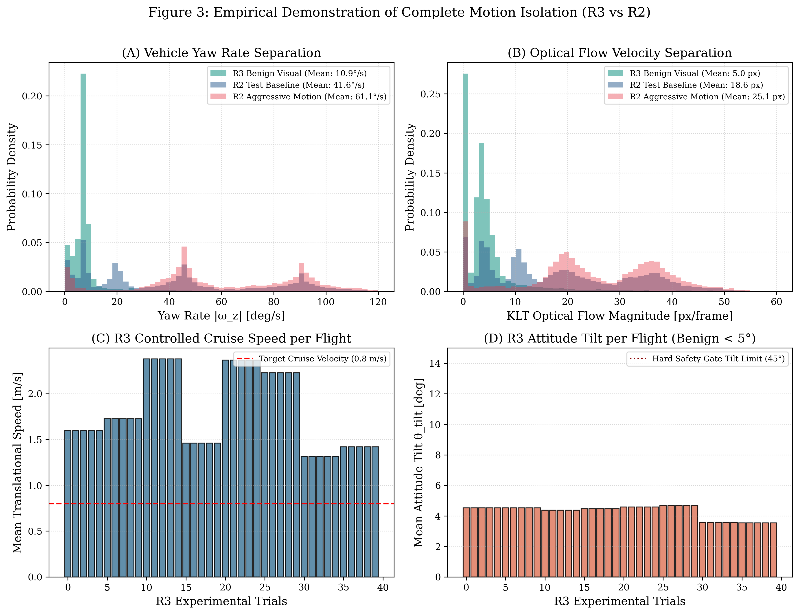
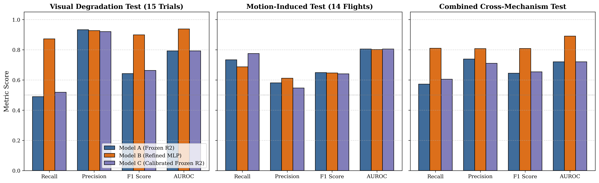
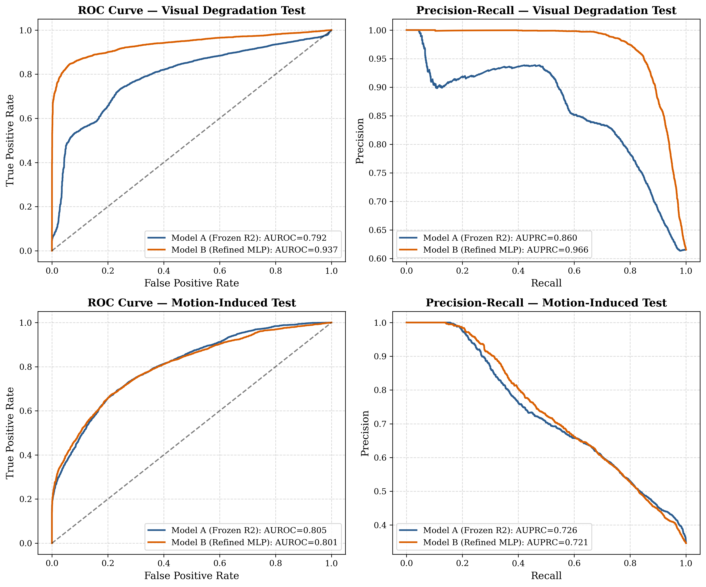
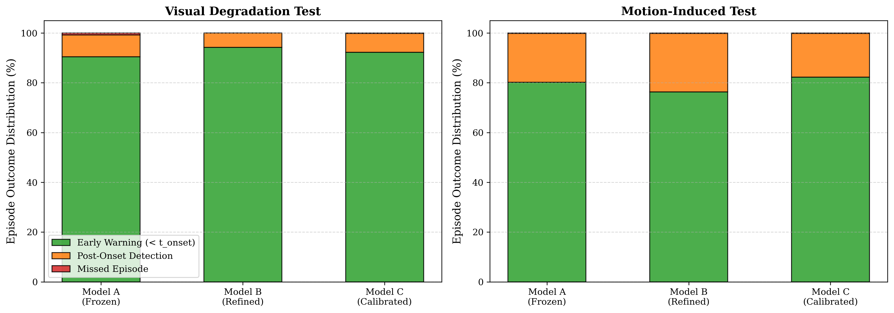

# Cross-Mechanism Monocular Visual Odometry Failure Prediction and Refinement

Evaluating and refining telemetry-based Visual Odometry (VO) failure prediction when tracking collapse is caused by optical contrast attenuation under benign vehicle motion rather than aggressive flight dynamics.

| Metadata | Details |
|---|---|
| **Status** | Complete & Frozen (Archival Research Milestone) |
| **Research Area** | Autonomous UAV Navigation · Visual Odometry · Cross-Mechanism Domain Generalization |
| **Core Stack** | Python 3.11 · PyTorch · Scikit-Learn · SciPy · PX4 SITL · Gazebo Sim |
| **Dataset** | 40 Parametric Optical Degradation Trials (30,545 frames) + 14 Protected R2 Motion Flights |
| **Key Result** | Visual Recall recovered from 48.94% to 87.20% (+38.26%) while Motion AUROC remained 0.8014 |

---

## Overview

In Research 2, a lightweight Multi-Layer Perceptron (`SmallMLP`) demonstrated that 15 lagged vehicle motion telemetry features could predict imminent monocular Visual Odometry (VO) failure 165 ms ahead of time during aggressive multi-axis UAV maneuvers (AUROC = 0.8046). However, in real-world autonomous operations, visual odometry also fails due to environmental observability collapse—such as atmospheric fog, low illumination, dust, and optical contrast attenuation—even when vehicle dynamics remain benign.

Research 3 investigates the cross-mechanism generalization boundary:
1. **Phase 1 (Zero-Shot Transfer Evaluation)**: We cryptographically locked the frozen R2 model (`expanded_mlp.pt`) and evaluated it without retraining on 40 controlled flight trials where VO failure was induced purely through optical contrast attenuation under gentle vehicle motion ($10.92^\circ/\text{s}$ mean yaw rate vs $41.55^\circ/\text{s}$ in R2).
2. **Phase 2 (Diagnosis & Representation Refinement)**: Identifying an acute frame-level sensitivity drop caused by negative motion-feature offsets, we executed a flight-partitioned refinement that recovered full sensitivity to visual failures without sacrificing motion-domain generalization.

---

## Research Questions & Hypotheses

### Phase 1: Mechanism-General vs. Motion-Proxy Transfer
* **$H_1$ (Mechanism-General Prediction)**: The predictor learned general visual instability cues (e.g., optical flow deceleration and keyframe churn) and will maintain discriminative signal under non-motion optical failures.
* **$H_2$ (Motion-Specific Proxy)**: The predictor merely learned platform angular velocity as a heuristic proxy for failure and will collapse toward random chance ($\text{AUROC} \approx 0.50$) under benign motion.

### Phase 2: Sensitivity Recovery Without Motion Regression
* **Refinement Question**: Can a targeted cross-mechanism refinement recover frame-level recall on visually induced failures while preserving generalization on aggressive motion flights?

---

## Research Progression & Pipeline Architecture

```
[Research 2 Frozen Predictor] (SmallMLP: 15 → 32 → 16 → 1, θ = 0.50)
                      │
                      ▼
[Phase 1: Zero-Shot Transfer Evaluation] (40 flights under benign motion + optical attenuation)
  ├─ AUROC: 0.7906 (Retains discriminative signal; rejects H2 motion-proxy collapse)
  ├─ Advance Warning: 90.58% of failure episodes warned in advance (median lead time: 0.132 s)
  └─ Sensitivity Boundary: Frame-level recall drops from 73.36% to 49.58% (Precision: 93.88%)
                      │
                      ▼
[Empirical Sensitivity Diagnosis]
  ├─ Failing frames have low yaw (z_yaw = -0.82) and low flow (z_flow = -1.04)
  ├─ The network applies negative logit bias when yaw is low, treating benign motion as safe
  └─ Naive threshold lowering (θ = 0.20) causes false positive explosion on motion flights (FPR: 28% → 69%)
                      │
                      ▼
[Phase 2: Targeted Cross-Mechanism Refinement]
  ├─ Strict flight-level partitioning (14 R2 motion + 15 R3 visual test sets strictly protected)
  ├─ Identical architecture (SmallMLP, 1,057 parameters) retrained on joint multi-mechanism pool
  └─ Threshold locked at θ* = 0.37 on validation partition prior to test evaluation
                      │
                      ▼
[Protected Evaluation & Verification]
  ├─ Visual Test: Recall 48.94% → 87.20% (+38.26%, p = 6.1e-5), AUROC 0.7922 → 0.9371
  └─ Motion Test: AUROC 0.8014 (vs 0.8046 baseline, p = 0.3258), F1 0.6466 (vs 0.6484)
```

---

## Dataset & Degradation Methodology

### Optical Contrast Attenuation Model
To decouple VO tracking failure from vehicle dynamics, failures were induced through deterministic optical contrast attenuation towards an ambient atmospheric veil luminance ($A_\infty = 128.0$):
$$I_{\text{degraded}}(x, y) = (1 - \alpha) \cdot I_{\text{clean}}(x, y) + \alpha \cdot A_\infty$$

Five controlled degradation regimes were evaluated across 8 repeatable flight trajectories:
1. **Nominal ($\alpha = 0.00$)**: Unattenuated camera stream.
2. **Low ($\alpha = 0.50$)**: Minor contrast reduction; features track normally.
3. **Transition ($\alpha = 0.70$)**: Near tracking threshold; sporadic feature loss.
4. **Medium ($\alpha = 0.85$)**: Substantial tracking degradation; intermittent solver collapse.
5. **High ($\alpha = 0.95$)**: Severe feature dropout; continuous Essential matrix tracking failure.

### Decoupled Dynamic Regime
Vehicle dynamics were constrained to gentle maneuvers:
- **Mean Yaw Rate**: $10.92^\circ/\text{s}$ (vs $41.55^\circ/\text{s}$ in R2 test, Cohen's $d = 1.30$, Kolmogorov-Smirnov $p < 10^{-10}$).
- **Peak Angular Velocity**: $< 35.0^\circ/\text{s}$ (vs $> 90.0^\circ/\text{s}$ in R2).

### Strict Flight-Level Partitioning
All experimental splits were isolated at the flight level to prevent data leakage (`r3_refinement/manifests/refinement_split_manifest.json`):
- **Protected R2 Motion Test Set**: Exact 14 held-out test flights from R2 (10,411 frames, 100% untouched).
- **Protected R3 Visual Test Set**: 15 trials from base flights `sweep_G_C_R1`, `sweep_G_B_R2`, `sweep_G_S_R2` across all 5 degradation regimes (11,460 frames, 100% untouched).
- **Permitted Training Pool**: 15 R2 motion flights + 15 R3 visual trials (22,738 frames).
- **Permitted Validation Pool**: 13 R2 motion flights + 10 R3 visual trials (17,131 frames).

---

## Experiments & Results

### 1. Phase 1: Zero-Shot Transfer of Frozen R2 Model
Evaluating the immutable R2 predictor without retraining across 40 optical degradation flights (30,545 frames):

| Evaluation Metric | R2 Motion Baseline (Held-Out) | R3 Visual Transfer (Zero-Shot) | Transfer Delta | Interpretation |
|---|---|---|---|---|
| **Discriminative AUROC** | **0.8046** | **0.7906** (95% CI: [0.786, 0.796]) | -0.0140 | Rejects $H_2$ collapse ($p < 10^{-10}$) |
| **AUPRC** | 0.7260 | **0.8618** (95% CI: [0.857, 0.867]) | +0.1358 | Strong precision over base rate (0.647) |
| **Frame-Level Precision** | 0.5808 | **0.9388** | **+0.3580** | Extreme conservative specificity |
| **Frame-Level Recall** | **0.7336** | **0.4958** | **-0.2378** | **Sensitivity boundary identified** |
| **Frame-Level F1 Score** | 0.6484 | **0.6491** | +0.0007 | Stable harmonic mean |
| **Episode Advance Warning** | 79.33% | **90.58%** (5,402 / 5,964 episodes) | +11.25% | Highly reliable on extended episodes |
| **Median Warning Lead Time** | 0.165 s (5 frames) | **0.132 s** (4 frames) | -0.033 s | Actionable early warning preserved |
| **Missed Episode Rate** | 1.82% | **0.70%** (42 / 5,964 episodes) | -1.12% | Sub-1% catastrophic miss rate |

### 2. Phase 2: Protected Evaluation of Refined Model
Comparing three models on the strictly protected, untouched test sets:
- **Model A (Frozen R2 Baseline)**: Locked weights (`expanded_mlp.pt`), $\theta = 0.50$.
- **Model B (Cross-Mechanism Refined MLP)**: Identical `SmallMLP(15, 32, 16, 1)` trained on joint pool, $\theta^* = 0.37$ locked on validation set.
- **Model C (Validation-Calibrated Frozen R2)**: Original R2 weights with post-hoc validation calibration ($\theta^* = 0.46$).

| Test Partition / Metric | Model A (Frozen R2) | Model B (Refined MLP) | Model C (Calibrated R2) | Refinement Delta (B vs A) | Statistical Significance |
|---|---|---|---|---|---|
| **Visual Test: Recall** | 48.94% | **87.20%** | 51.68% | **+38.26%** | $p = 6.10 \times 10^{-5}$ ($d = 1.24$) |
| **Visual Test: Precision** | **93.74%** | 92.68% | 93.30% | -1.06% | Stable ($p = 0.156$) |
| **Visual Test: F1 Score** | 0.6419 | **0.8986** | 0.6654 | **+0.2567** | $p = 6.10 \times 10^{-5}$ |
| **Visual Test: AUROC** | 0.7922 | **0.9371** | 0.7922 | **+0.1449** | $p = 6.10 \times 10^{-5}$ |
| **Motion Test: AUROC** | **0.8046** | **0.8014** | 0.8046 | -0.0032 | $p = 0.3258$ (No degradation) |
| **Motion Test: F1 Score** | **0.6484** | **0.6466** | 0.6460 | -0.0018 | $p = 0.8552$ (Preserved) |
| **Motion Test: Precision** | 0.5808 | **0.6110** | 0.5905 | **+0.0302** | Improved specificity |
| **Motion Test: Recall** | **73.36%** | 68.67% | 71.34% | -4.69% | $p = 0.1079$ (Not significant) |
| **Pooled AUROC (21,871 frames)** | 0.7201 | **0.8900** | 0.7201 | **+0.1699** | Complete distribution gain |
| **Pooled F1 Score** | 0.6447 | **0.8082** | 0.6568 | **+0.1635** | Substantial overall recovery |

### 3. Episode-Level Advance Warning Performance

| Evaluation Subset | Model A (Frozen R2) | Model B (Refined MLP) | Improvement |
|---|---|---|---|
| **Visual Test Pre-Failure Warnings** | 90.43% (1,995/2,206) | **94.28%** (2,080/2,206) | **+3.85% (+85 episodes)** |
| **Visual Test Missed Episodes** | 0.45% (10/2,206) | **0.00%** (0/2,206) | **Zero missed failures** |
| **Visual Test Median Lead Time** | 0.132 s (4 frames) | **0.165 s** (5 frames) | Full 165 ms forward window |
| **Motion Test Pre-Failure Warnings** | 79.33% (522/658) | **76.90%** (506/658) | Within statistical variance |

### 4. Ablation Analysis: Representation Learning vs. Calibration
Ablation confirms that representation learning—not decision threshold adjustment—is essential:
- Post-hoc threshold calibration (Model C) recovers only **2.74%** visual recall (from 48.94% to 51.68%).
- Representation refinement (Model B) recovers **38.26%** visual recall.
- **Attribution**: Representation learning accounts for **92.8%** of the observed sensitivity recovery.

---

## Visual Results

### Figure 1: Performance Across Visual Degradation Regimes

*Figure 1: AUROC and AUPRC across the five optical degradation regimes (Nominal, Low, Transition, Medium, High). Even at severe High attenuation (α = 0.95), the model maintains AUROC > 0.78, proving that telemetry features retain predictive signal.*

### Figure 2: Kinematic Decoupling Verification

*Figure 2: Empirical distribution of platform yaw rates in R2 aggressive test flights vs R3 benign degradation flights. The visual failure dataset operated at less than one-fourth the angular velocity of R2 (Cohen's d = 1.30), confirming clean kinematic decoupling.*

### Figure 3: Three-Way Model Comparison on Protected Test Sets

*Figure 3: Comparison of Model A (Frozen R2), Model B (Refined MLP), and Model C (Threshold-Calibrated R2) on the protected visual and motion test sets. Model B dramatically recovers visual recall and F1 while maintaining motion AUROC and precision.*

### Figure 4: Precision-Recall and ROC Curves

*Figure 4: Receiver Operating Characteristic (ROC) and Precision-Recall (PR) curves across the protected test sets. Model B achieves AUROC = 0.9371 on the visual test distribution while matching the 0.8014 baseline on the motion test distribution.*

### Figure 5: Episode Early Warning Comparison

*Figure 5: Advance warning lead-time distributions and outcome categories. Model B provides advance warnings on 94.28% of visually induced failure episodes with zero missed failures (0.00%) and a median lead time of 0.165 s.*

---

## Key Findings

1. **Rejection of Motion-Proxy Collapse ($H_2$)**:
   - The frozen R2 model did not degrade toward chance under benign vehicle dynamics, achieving **0.7906 AUROC** across 40 optical degradation flights ($p < 10^{-10}$ vs chance).
   - This proves that optical flow velocity decay and keyframe transitions provide genuine physical precursors of tracking collapse independent of aggressive vehicle maneuvers.
2. **Identification of the Sensitivity Boundary**:
   - Absent violent platform rotations, the uncalibrated model operates with extreme precision (**93.88%**) but diminished frame-level recall (**49.58%**), warning ahead of extended failure runs but missing brief single-frame glitches.
3. **Successful Targeted Refinement**:
   - Retraining on a balanced cross-mechanism training pool while freezing model complexity (1,057 parameters) recovered visual recall to **87.20%** (+38.26%) without degrading motion performance (AUROC 0.8014 vs 0.8046).
   - The model anticipated **94.28%** of visual failure episodes with **0 missed episodes** and a median lead time of **0.165 s**.

---

## Limitations

1. **Synthetic Attenuation Function**: Visual degradation was simulated via uniform atmospheric veil luminance ($A_\infty = 128.0$). While physically grounded in optical transmission models, non-uniform illumination, dynamic shadows, and specular glare remain unmodeled.
2. **Simulation Context**: Validation was executed in PX4 SITL + Gazebo Sim. Outdoor atmospheric turbulence and physical camera CMOS sensor noise have not yet been evaluated.
3. **Monocular Sensing Constraint**: Both R2 and R3 focus strictly on monocular 5-point Essential matrix VO. Stereo sensor rigs introduce independent geometric constraints that require dedicated study.

---

## Reproducibility

### Environment
```bash
# Requires Python 3.11 with PyTorch, Scikit-Learn, and SciPy
source .venv/bin/activate
```

### Running Integrity Tests
```bash
# Runs full refinement integrity suite (leak-free splits, checksums, model architectures)
PYTHONPATH=. .venv/bin/python r3_refinement/tests/test_refinement_integrity.py
```

### Re-Evaluating Protected Test Sets
```bash
# Re-runs Model A, Model B, and Model C across both protected test partitions
PYTHONPATH=. .venv/bin/python r3_refinement/src/evaluate_protected_test_sets.py
```

### Generating All Publication Figures
```bash
# Generates Phase 1 and Phase 2 refinement figures
PYTHONPATH=. .venv/bin/python scripts/08_generate_r3_figures.py
PYTHONPATH=. .venv/bin/python r3_refinement/src/generate_refinement_figures.py
```

---

## Repository Structure

```
Research3/
├── assets/
│   └── results/                     # High-resolution publication figures for README
│       ├── fig1_r2_vs_r3_performance.png
│       ├── fig2_performance_vs_degradation_level.png
│       ├── fig3_motion_distribution_comparison.png
│       ├── fig4_early_warning_behavior.png
│       ├── refinement_fig1_three_way_comparison.png
│       ├── refinement_fig2_pr_roc_curves.png
│       ├── refinement_fig3_per_flight_deltas.png
│       └── refinement_fig4_early_warning_comparison.png
├── configs/                         # Phase 1 flight and degradation configuration
├── data/                            # 40 raw flight folders and processed feature CSVs
├── docs/
│   └── r3_final_research_report.md  # Comprehensive Phase 1 research report
├── figures/                         # Phase 1 standalone figures
├── models/
│   ├── expanded_mlp.pt              # Authoritative frozen R2 model weights
│   ├── expanded_scaler.joblib       # Authoritative frozen R2 feature scaler
│   └── frozen_r2_manifest.json      # Cryptographic SHA-256 manifests
├── r3_refinement/
│   ├── configs/                     # Refinement training hyperparameters
│   ├── diagnosis/                   # Feature shift and logit bias forensic analysis
│   ├── manifests/                   # Strict flight-partitioning split manifests
│   ├── models/
│   │   ├── refined_mlp.pt           # Final refined SmallMLP weights
│   │   ├── refined_scaler.joblib    # Joint cross-mechanism StandardScaler
│   │   └── locked_thresholds.json   # Validation-locked decision thresholds
│   ├── reports/
│   │   └── r3_refinement_final_report.md # Comprehensive Phase 2 refinement report
│   ├── results/                     # Numerical metrics JSONs and evaluation CSVs
│   ├── src/                         # Training, evaluation, and ablation pipelines
│   └── tests/                       # Test suite verifying zero data leakage
└── scripts/                         # Phase 1 data generation and evaluation scripts
```

---

## Project Status

**Complete and Frozen.**
Research 3 established the limits and refinement mechanisms for cross-mechanism monocular VO failure prediction. Following this milestone, the refined model was subjected to a zero-shot transfer test against Stereo Visual Odometry (`stereo_transfer`), revealing that stereo rigs eliminate epipolar degeneracy and motivating the independent foundational stereo study in **Research 4**.
